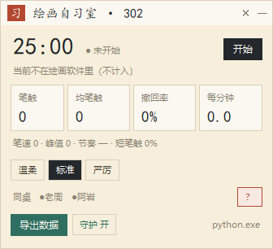

# 绘画自习室 · Paint Study Room

一个**不碰画布**的绘画练习记录器：读 Windows 全局指针，把落笔切成一笔一笔的「笔触」，量化你到底在怎么画——画了多少笔、每笔多长、撤回了几次、节奏有没有散。旁边再放一张「自习桌」，同房间的人能看见你在画、能给你发问号。

两种形态，同一套口径：**单文件 HTML**（双击即开，含音效）和 **Windows 桌面悬浮小窗**（Python 标准库，置顶无边框，浮在你的绘画软件上方）。

**在线 demo**：<https://duyv0826.github.io/paint-studio/>（浏览器直接打开，音效已内嵌）
**Windows 免安装版**：[Releases v0.9.1](https://github.com/duyv0826/paint-studio/releases/tag/v0.9.1)（38 MB，不需要装 Python）



---

## 它回答的问题

画画时最难自察的不是「画得好不好」，是「刚才那 40 分钟我到底在干什么」。常见的自评是无效的：凭感觉、看成品、或者干脆不知道。这个工具绕开画面内容，只记录手的动作：

- **笔触**：左键按下到抬起算一笔，记时长、累计轨迹长度、平均/峰值速度、笔内停顿、直线度（位移÷轨迹，1 = 很直，低 = 来回描）。
- **撤回**：Ctrl+Z 后 3 秒内归给「最近画完的那一笔」，算撤回率。
- **节奏**：相邻两笔的间隔中位数、MAD 比、90 分位、超长停顿次数。
- **笔速断崖**：峰值还很高却突然掉速并持续，判定为「断崖」，触发提醒。

一句话：**笔触是手的动作留下的形状，不是画面内容，也不是压感。画面好不好它不知道；它知道你有没有在动、动得像不像在画。**

内部口径来自一份 0.5–0.9 的逐版改动记录（`docs/改动记录/`），每个数字都写过「为什么这么取」，包括哪些指标只能做对照、不能进假设检验（例如 `rhythm_cv` 对单个长停顿极敏感，一次 30 秒起身就能把整场判成「散」）。

---

## 快速开始

### 方式一：单文件 HTML（零安装）

```
web/绘画自习室_单文件版_v0.7.html     # 3 MB，音效已内嵌，双击用浏览器打开
web/绘画自习室_原型_v0.7.html         # 77 KB 开发版，音频从 web/sfx/ 读
```

### 方式二：桌面悬浮小窗（推荐）

```bat
python src\paint_studio_widget.py
python src\paint_studio_widget.py --name 小林 --room 302 --pass x7k
python src\paint_studio_widget.py --selftest      :: 不开窗，跑 36 项逻辑自检
```

也可以用 `src\启动小窗.bat`：有打包好的 exe 就跑 exe，没有就用本机 Python 拉起脚本。

要求：Windows + Python 3.9+（实测 3.12）。**没有 pip 依赖**——`tkinter` 界面、`ctypes` 挂钩子、`socket` 走联机，全是标准库。

### 三步上手

1. 打开小窗，点标题改昵称和桌号（下次自动记住）。
2. 打开你的绘画软件（PS / SAI / CSP / Krita / Painter…），照常画。只有白名单里的程序在前台时笔触才计入，右下角会显示当前前台程序名。
3. 点「开始」，25 分钟番茄钟走起来；点「导出数据」得到 JSON。

---

## 目录结构

```
src/          paint_studio_widget.py   桌面小窗主程序（2,029 行，单文件）
              启动小窗.bat
web/          绘画自习室_单文件版_v0.7.html   自包含版本（内嵌音效）
              绘画自习室_原型_v0.7.html       开发版（读 web/sfx/）
              sfx/                           13 条音效 wav
docs/         使用说明.md            界面逐块讲解 / 导出字段表 / 已知限制 / 参数全表
              自检结果_20261114.txt  PASS 36/36 的原始报告
              改动记录/             v0.5 → v0.8 每版的改动与验证说明
tools/        标定/                 笔速标定采集页 + 分位分析（.mjs）
              sfx/                  音效归一、循环接缝修复、电平分析脚本
tests/        钩子换算/多屏/旋转屏/过期表兜底的实测脚本
screenshots/  界面与实验条件（含盲化对照）截图
```

---

## 三处值得看的地方

### 1. 落笔点：钩子给的是物理像素，光标给的是虚拟像素

进程没声明 DPI 感知时，`GetCursorPos` 报虚拟化坐标，`WH_MOUSE_LL` 钩子报物理像素。本机 4K 那屏是 2 倍（系数 0.5），2560×1440 那屏 1.5 倍（0.667）。程序按「每块屏的虚拟矩形 ÷ 物理矩形」各算一个系数，写进导出文件的 `source.dpi_monitors`。

三重兜底：换算表每 10 秒或落点跑出所有已知屏时自动重读（插拔、改缩放宽限期 10 秒内自愈）；按下点与当拍光标偏差 >120 px 判为尺子错位，退回当拍坐标并记 `hook_scale_warn`；`--hook-scale` 可手动钉死系数。竖屏按旋转后的像素独立算 x/y。这些都有真机脚本可复跑，见 `tests/`。

### 2. 联机：没有服务器，也不打扰你

同一桌号的两个人，两条通道同时开、谁先到算谁：局域网组播（`239.255.60.60:47826`，同一 Wi-Fi 零配置，断网可用）和公共 MQTT（TLS 8883，`broker.emqx.io` → `broker.hivemq.com` → `test.mosquitto.org` 依次试、断久了自动换）。房间主题可选口令参与哈希，光猜到桌号进不来。

房间里只放昵称、状态、笔数、问号——**这是设计边界，不是加密聊天**，别往里塞敏感内容。

### 3. 实验条件可盲化

同一套程序要跑「有同桌 / 独桌」的被试内对比，界面本身就可能是需求特征。所以有 `--solo --covert`：独桌条件下仍然显示「同桌（离线）」的座位行、不出现「独桌」二字、徽标固定显示「仅局域网」，视觉上与有同桌条件等量。再配 `--pid P01 --session 2 --piece B --order AB1`，被试编号、场次、练习稿、ABBA 块都写进导出文件名和 `session` 块，二十多场不会配错对。

---

## 导出数据

点「导出数据」得到 `自习室_<档位>_<with_peers|system_only>_<时间戳>.json`（`schema_version: 3`），分五块：

| 块 | 内容 |
|---|---|
| `source` | 是否走钩子、每屏换算表、重读/变化次数、钩子偏差、白名单、采样率 |
| `session` | 起止、有效秒数、实验条件、计划时长 |
| `desk` | 总笔数/撤回数/路径/落笔秒/速度，`brush` 聚合（均长、中位、短笔触占比、撤回率、节奏、停顿），最近 300 笔原始记录 |
| `guard` | 提醒次数与每次的 `signal`(idle/cliff)、`delay_ms`（提醒后多久回笔）、触发时的前台程序 |
| `room` / `pomodoro` | 房间与同桌状态、问号往来（`after_reminder_ms` / `reaction_ms`）、番茄钟轮次与真正专注秒数 |

外加 `data_valid` 与 `limits`（五条已知限制随数据一起走，脱库也不会被误读）。

字段逐条解释在 `docs/使用说明.md` 第 5、6 节。

---

## 已知限制（不粉饰）

1. **没有压感/倾角**。读笔压要订阅数位板 HID 原始报文，各品牌不同。笔触是几何口径，不是力度口径。
2. **撤销靠 Ctrl+Z**。用面板按钮或 `Ctrl+Shift+Z` 撤销会漏记。
3. **落笔＝左键按下**。个别驱动改了映射要自己在开场前空画两笔确认笔触在涨。
4. **只认前台白名单**（PS、SAI、CSP、Krita、Painter 等 24 个进程名），冷门软件加进 `DRAW_EXES` 或用 `--anywhere`。
5. **公网通道依赖第三方免费 broker**，无 SLA；三个都连不上时只剩局域网，界面显示「仅局域网」。
6. 口令是弱保护：broker 上拿到哈希即可订阅，别传敏感内容。
7. **只支持 Windows**。macOS 要另写一套（`CGEventTap`）。

---

## 自检

```
python src\paint_studio_widget.py --selftest     # 36 项，报告写到 自检结果.txt
python src\paint_studio_widget.py --net-test     # 局域网通道
python src\paint_studio_widget.py --probe 5      # 只读 5 秒全局指针
```

当前状态：**PASS 36/36**（2026-11-14，见 `docs/自检结果_20261114.txt`）。覆盖笔触切分、撤回归属、静默与断崖两类提醒、钩子补点、尺子校验、双屏/竖屏/远程桌面兜底、例行重读不误记。远程桌面与实际旋转竖屏当时未实测，脚本留档待补。

---

## 许可

代码以 **MIT** 释出，见 `LICENSE`。音效为项目内自产（合成/生成后做电平归一与循环接缝处理），随项目一并释出；若要商用，请自行确认所用作曲/生成工具的服务条款。
